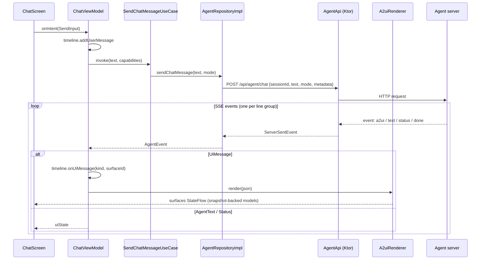

# A2UI Agentic Chat (Android)

A Jetpack Compose proof of concept: a chat agent that answers with **native Material 3 UI**, generated on the
server with the [A2UI protocol](https://a2ui.org/) and rendered on the device by the
[Compose A2UI renderer](https://developer.android.com/develop/ui/compose/agentic)
(`androidx.a2ui` 1.0.0-alpha02).

The app has two screens:

| Home | Chat |
|---|---|
| Server status, agent mode switch (Mock / Hybrid / LLM), **Launch agent** button | Conversation with inline agent-generated UI, mode menu, new conversation |

The agent server lives in [`a2ui-agent-server/`](a2ui-agent-server/README.md). Read its
[Concepts guide](a2ui-agent-server/docs/01-concepts.md) first if A2UI is new to you.

## Quick start

1. **Start the server** (Node 20+):
   ```bash
   cd a2ui-agent-server && npm install && npm run mock     # or `npm start` with an LLM configured in .env (Gemini, Claude or custom)
   ```
2. **Run the app** on an emulator from Android Studio, or with `./gradlew :app:installDebug`.
   The emulator reaches your computer at `http://10.0.2.2:3000`, which is the default.
3. On the home screen, check that the server shows **Online**, pick a mode, and tap **Launch agent**.
   Try the suggestions: *hi*, *Plan a trip to Lisbon*, *Self-heal demo*.

**Physical device:** set the server address in `gradle.properties` (`agentBaseUrl=http://192.168.1.20:3000`),
or run `adb reverse tcp:3000 tcp:3000` and use `agentBaseUrl=http://localhost:3000`. Plain HTTP is allowed in
**debug** builds only (`app/src/debug/res/xml/network_security_config.xml`).

### Agent modes

The mode is stored with DataStore and sent with every request as `mode`. A change applies from the next message.

| Mode | Server behavior |
|---|---|
| Mock | Scripted demos only. Deterministic, no API key needed. Best for live demos |
| Hybrid | Scripted demos for known prompts, the server's LLM for everything else (default) |
| LLM | Every prompt goes to the server's LLM: Gemini, Claude or a custom OpenAI-compatible model (see the server README) |

## Architecture

Clean Architecture in one module, layered by package, with **MVI** in the presentation layer.

```
com.sdz.smpl.a2ui
├── domain/            Pure Kotlin. No Android, Ktor or A2UI types.
│   ├── model/         AgentMode, AgentEvent, ClientMessage, ServerStatus
│   ├── repository/    AgentRepository, SettingsRepository (interfaces)
│   └── usecase/       SendChatMessage, SendClientMessage, GetServerStatus, StartNewConversation,
│                      ObserveAgentMode, SetAgentMode
├── data/              Implements the domain interfaces.
│   ├── remote/        AgentApi (Ktor POST → SSE stream), SseEventParser, DTOs, JSON helpers
│   ├── mapper/        SSE event → AgentEvent, ClientMessage → A2UI client-to-server JSON
│   └── repository/    AgentRepositoryImpl (holds the server session id), SettingsRepositoryImpl (DataStore)
├── ui/                Presentation (Compose + ViewModels).
│   ├── a2ui/          A2uiRenderer (wraps A2uiMessageParser + A2uiMessageProcessor), app catalog
│   ├── home/          HomeContract (State / Intent / Effect), HomeViewModel, HomeScreen
│   ├── chat/          ChatContract, ChatViewModel, ChatTimeline (pure reducer), ChatScreen, components/
│   ├── components/    AgentModeSelector (shared)
│   ├── navigation/    AppNavHost (type-safe routes)
│   └── theme/
├── di/                AppContainer (manual DI), AppViewModelFactory
├── A2uiChatApplication.kt
└── MainActivity.kt
```

Dependencies point inward: `ui` → `domain` ← `data`. The A2UI library is used only in `ui/a2ui` and in the chat
UI that renders surfaces. The domain sees A2UI messages as raw JSON strings and `ClientMessage`s.

### MVI

Each screen has a **contract** file:

- `…UiState`: one immutable data class with everything the screen draws. It's exposed as a `StateFlow` and
  collected with `collectAsStateWithLifecycle`.
- `…Intent`: a sealed interface of user actions. The screen calls `viewModel.onIntent(intent)`, which is
  its only entry point.
- `…Effect`: one-off events (navigation, snackbars), sent through a `Channel` and collected in a `LaunchedEffect`.

Every screen is split into a **stateful `…Route`** (gets the ViewModel and handles effects) and a
**stateless `…Screen(state, onIntent)`**, which is previewable and UI-testable without a ViewModel.

### How a chat turn works



**Back channel:** when the user taps a button inside an agent surface, or the renderer rejects a component, the
renderer emits a `ClientMessage` on `outboundMessages`. `ChatViewModel` forwards it with
`SendClientMessageUseCase` to `POST /api/agent/event`, and the reply streams back exactly like a chat turn.

**One turn at a time:** turns run in order under a `Mutex`. An action tapped while the agent is still answering
is queued, never interleaved.

**Where surfaces appear:** `ChatTimeline` is a pure, unit-tested reducer. A surface is placed where its
`createSurface` arrived, moves to the end if it is re-created, and disappears on `deleteSurface`. Its live content
comes from `A2uiRenderer.surfaces`.

### A2UI integration notes

| Topic | What the app does | Where |
|---|---|---|
| Catalog | Material 3 basic catalog (`materialA2uiBasicCatalogV1`) with Coil for `Image`; `Video`/`AudioPlayer` show a placeholder | `ui/a2ui/AppA2uiCatalog.kt` |
| Parsing | `processor.processInput(parser, json)`: invalid payloads become client errors, never crashes | `A2uiRenderer.render` |
| Processing loop | `processor.collectMessages()` on `Dispatchers.Default`, scoped to the ViewModel | `ChatViewModel.init` |
| Outbound events | Collected with `CoroutineStart.UNDISPATCHED` before anything renders (the flow doesn't replay) | `ChatViewModel.init` |
| Capabilities | `A2uiClientCapabilities(listOf(catalog.id)).toPayloadMap()` sent as request metadata | `A2uiRenderer.capabilitiesMetadata` |
| Data model | Attached by the library to actions (`clientDataModel`) and forwarded as metadata | `ChatViewModel.forwardToAgent` |
| Wire format | The library has no JSON serializer for client messages, so the app builds the spec envelope (ISO timestamp, `path` for validation errors) | `data/mapper/RequestBodyMapper.kt` |
| Nested scrolling | The catalog's `List` is a `LazyColumn`, so each surface is capped with `heightIn(max = 560.dp)` inside the chat's `LazyColumn` | `AgentSurfaceCard` |

## Build configuration notes

- **`compileSdk` 37.2** (`release(37) { minorApiLevel = 2 }`): the A2UI libraries require API 37.1 or later.
- **Coil 3.4.0**: Coil 3.5+ is compiled with Kotlin 2.4, which this project's Kotlin 2.2 compiler can't read.
  Upgrade Kotlin and Coil together.
- **Ktor CIO `requestTimeout = 0`**: an agent turn is one long SSE response, and CIO's default 15 s timeout
  would cut it.
- No XML/View Material dependency. The window theme is `android:Theme.Material.Light.NoActionBar`, and all
  styling is in Compose.

## Testing

```bash
./gradlew :app:testDebugUnitTest             # JVM unit tests (30)
./gradlew :app:connectedDebugAndroidTest     # instrumented tests, needs an emulator/device
```

| Test | What it covers |
|---|---|
| `SseEventParserTest` | SSE framing: comments, multi-line data, flushing at end of stream |
| `AgentEventMapperTest` | SSE event → domain event, A2UI envelope detection |
| `RequestBodyMapperTest` | Request bodies and spec-compliant action/error envelopes |
| `AgentRepositoryImplTest` | Real Ktor client against `MockEngine`: streaming, session tracking, HTTP errors, `/health` |
| `ChatTimelineTest` | Surface placement rules |
| `HomeViewModelTest` | MVI state and effects with fake repositories |
| `AppA2uiCatalogTest` (instrumented) | The app catalog through `A2uiTestController`: action dispatch with resolved context, two-way binding |
| `ChatScreenTest` (instrumented) | Stateless chat screen: suggestions, send enablement, intents |

## Known issue (androidx.a2ui 1.0.0-alpha02)

**Relative bindings in a button's action context inside a List template are not resolved per item.**
The Material `Button` dispatches its raw action, and the engine resolves `context` against the surface root
instead of the template item. So in the stays list, `{"path": "name"}` resolves to `/name`, which is missing,
and the server gets an empty value. Display bindings (`Text`, `formatString`) inside templates are resolved per
item and work.

This was confirmed on an emulator; the cause is in `A2uiComponentScopeImpl.dispatchAction` → `A2uiActionHandler`.

**Workaround in place:** the server's scripted stays demo doesn't use a template for its result cards. It sends
one card per stay, with the Book button's context as literal values (`src/agent/scripted.js`, `stayCard()`).
For agent-generated (LLM) UI, the system prompt (`src/agent/prompt.js`) tells the model not to put buttons with
path-based contexts inside templates and to emit per-item buttons with literal values instead. This is a prompt
rule, so the model can still ignore it.

## Troubleshooting

| Symptom | Fix |
|---|---|
| Home shows **Offline** | Start the server; on a device, check `agentBaseUrl` or use `adb reverse` |
| `CLEARTEXT communication … not permitted` | Use a debug build, or serve the agent over HTTPS |
| Surfaces never appear | Check the server logs; the app only renders surfaces whose catalog id it advertised |
| Images blank | The device needs internet access (`picsum.photos`) |
| LLM mode replies with the demo menu | The server has no LLM provider configured; the home screen shows this too |
