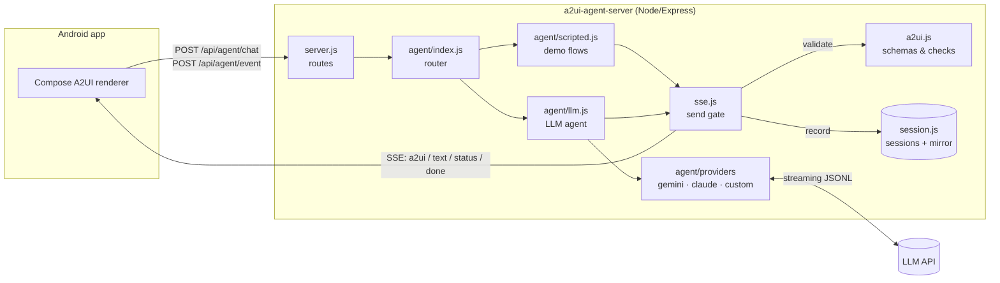
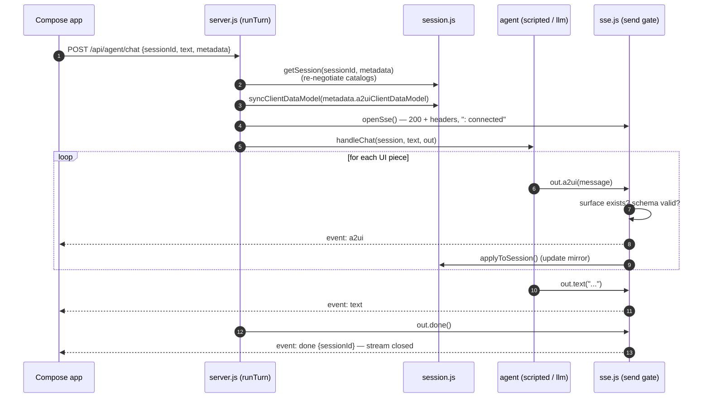
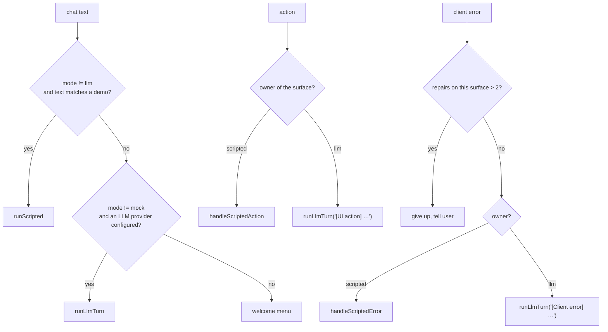
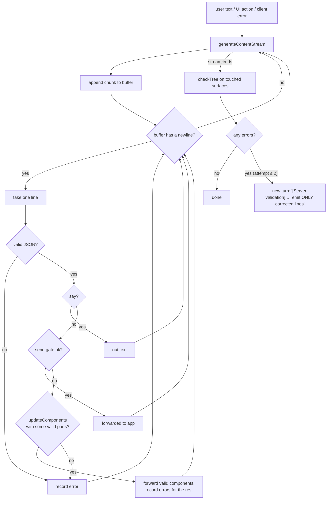

# 2. Architecture

How the server turns a chat message into a stream of A2UI messages. Read [1. Concepts](01-concepts.md) first
if terms like *surface* or *data model* are new to you.

- [The big picture](#the-big-picture)
- [Module map](#module-map)
- [Lifecycle of one request (a "turn")](#lifecycle-of-one-request-a-turn)
- [Routing: scripted demos vs. LLM](#routing-scripted-demos-vs-llm)
- [The SSE channel and the "send gate"](#the-sse-channel-and-the-send-gate)
- [Validation: three layers](#validation-three-layers)
- [Sessions and the surface mirror](#sessions-and-the-surface-mirror)
- [The LLM agent in detail](#the-llm-agent-in-detail)
- [The scripted demos in detail](#the-scripted-demos-in-detail)
- [Design decisions](#design-decisions)
- [Known limitations](#known-limitations)

---

## The big picture



In one sentence: a request comes in, the router picks **scripted** or **LLM** handling, and the handler produces
A2UI messages. Every message passes through the **SSE send gate**, which validates it, streams it to the app, and
records it in the session.

---

## Module map

| File | Responsibility | Key exports |
|---|---|---|
| `server.js` | Express app, HTTP routes, turn lifecycle (`runTurn`) | – |
| `src/a2ui.js` | Protocol layer: message builders, Ajv schema validation, tree checks, JSON Pointer helper | `createSurface`, `updateComponents`, `updateDataModel`, `deleteSurface`, `validateServerMessage`, `validateClientMessage`, `partitionComponents`, `checkTree` |
| `src/catalog.js` | Catalog negotiation from client capabilities; turns a catalog schema into a compact text summary for the prompt | `negotiateCatalogs`, `describeCatalog` |
| `src/session.js` | In-memory sessions and a mirror of each surface (components and data model) | `getSession`, `applyToSession`, `describeSurfaces` |
| `src/sse.js` | SSE response wrapper: heartbeats, abort on disconnect, the send gate | `openSse`, `sleep` |
| `src/agent/index.js` | Decides who handles a chat message, action, or client error | `handleChat`, `handleAction`, `handleClientError` |
| `src/agent/scripted.js` | Deterministic demo flows (welcome, trip → stays → booking, self-heal) | `matchScripted`, `runScripted`, `handleScriptedAction`, `handleScriptedError` |
| `src/agent/llm.js` | LLM streaming: parse JSONL, validate, forward, repair loop | `runLlmTurn`, `llmAvailable`, `llmInfo` |
| `src/agent/providers/` | Provider interface and implementations: Gemini, Claude, custom (OpenAI-compatible) | `selectProvider` |
| `src/agent/prompt.js` | Builds the LLM system prompt (rules, catalog, example, current surfaces) | `buildSystemPrompt` |
| `schemas/v0_9/*.json` | Official A2UI v0.9 JSON Schemas, copied from a2ui.org | – |
| `scripts/smoke.mjs` | End-to-end test that acts like the Android client | – |

Dependency direction: `server.js` → `agent/*` → `sse.js` / `session.js` / `catalog.js` → `a2ui.js`.
`a2ui.js` depends on nothing else in the project.

---

## Lifecycle of one request (a "turn")

Every request, whether a chat message, an action, or an error report, is one **turn**. A turn opens an SSE
stream, emits zero or more events, and **always** ends with `done`.



The matching code in `server.js`:

```js
async function runTurn(req, res, fn) {
  const session = getSession(req.body.sessionId, req.body.metadata); // 1. who is this?
  syncClientDataModel(session, req.body.metadata);                   // 2. latest form values from the app
  const out = openSse(req, res, session);                            // 3. start streaming
  try { await fn(session, out); }                                    // 4. produce UI
  catch (err) { out.error(err?.message ?? 'Agent failed'); }         //    report failures as an SSE event
  finally { out.done(); }                                            // 5. always close cleanly
}
```

If the user leaves the screen and the HTTP connection drops, `res.on('close')` aborts `out.signal`. That stops
the LLM request and any `sleep()` in the demo flows.

---

## Routing: scripted demos vs. LLM

`src/agent/index.js` decides who handles each turn, based on the session's **mode**. The mode is the request's
`mode` field if present (the Android app sends the mode the user picked), else the session's previous mode,
else the server default `AGENT_MODE`:



Each surface remembers its **owner** (`'scripted'` or `'llm'`), the code path that created it. A button tap
is therefore always routed back to whatever created the button.

| Mode | Behavior | Use when |
|---|---|---|
| `mock` | Scripted demos only; no API key needed | Live demos, offline development, client development |
| `hybrid` (default) | Known prompts use scripted demos, everything else goes to the LLM | Showing both reliability and flexibility |
| `llm` | Everything goes to the LLM | Testing the prompt and LLM behavior |

---

## The SSE channel and the "send gate"

`openSse()` in `src/sse.js` wraps the HTTP response. Handlers never write to `res` directly. They call:

| Method | Emits | Notes |
|---|---|---|
| `out.a2ui(msg, opts)` | `event: a2ui` | The **send gate**, described below |
| `out.text(str)` | `event: text` | Chat bubble |
| `out.status(str)` | `event: status` | Transient hint like "Thinking…" |
| `out.error(str)` | `event: error` | Turn failed |
| `out.done()` | `event: done` | Called by `runTurn`; ends the response |
| `out.signal` / `out.closed` | – | Abort signal and flag for client disconnects |

`out.a2ui()` is the only way an A2UI message reaches the app. In order, it:

1. **Checks surface state.** Updating a surface that doesn't exist, or creating one that already exists, is
   rejected. This catches mistakes that the schema alone can't see.
2. **Validates against the schema** (`validateServerMessage`), using the surface's catalog.
3. **Writes** the SSE event.
4. **Updates the mirror** (`applyToSession`), so the server always knows what the app is showing.

It returns `{ ok, errors }` instead of throwing, so the caller decides what to do. The LLM agent collects errors
for repair; the scripted demos throw, because a rejected scripted message is a bug.

`skipValidation: true` exists **only** for the self-healing demo, which needs to send a broken component on purpose.

Wire format (one event per message; `data` is always single-line JSON):

```
id: 3
event: a2ui
data: {"version":"v0.9","updateDataModel":{"surfaceId":"booking","path":"/status","value":"Holding your room…"}}

```

The `X-Accel-Buffering: no` and `Cache-Control: no-transform` headers stop proxies from buffering the stream.
A `: ping` comment every 15 s keeps idle connections alive.

---

## Validation: three layers

LLMs make mistakes, so validation is the core of a reliable agent. This server validates at three points:

| # | Where | What it catches | On failure |
|---|---|---|---|
| 1 | `validateServerMessage()` (send gate) | Wrong message shape, unknown component, missing required prop, bad enum value, unknown property | Message held back. LLM: invalid components are dropped from the batch, valid ones still go out, and errors go to the repair turn |
| 2 | `checkTree()` (after each LLM attempt) | No `root`, or references to ids that were never sent | Repair turn |
| 3 | The Compose engine on the device | Anything else the app's catalog implementation rejects | App posts `VALIDATION_FAILED`, the server repairs that surface (max 2 times) |

Layer 1 uses the **official** schemas in `schemas/v0_9/` with [Ajv](https://ajv.js.org/). Errors are rewritten
into short, specific messages that an LLM can act on:

```
component[1] "t" (Text)/variant: must be equal to one of the allowed values ["h1","h2","h3","h4","h5","caption","body"]
component[0] "root": unknown component "Colum" (allowed: Text, Image, Icon, …)
component[3] "wx-temp" (Text): unknown property "content"
```

> Components on surfaces that use a **custom/inline catalog** get structural checks only (`id` and `component`
> must be strings). Their full schema validation is left to the app (layer 3).

---

## Sessions and the surface mirror

`src/session.js` keeps one object per conversation in memory:

```js
session = {
  id: 'uuid',                         // returned to the app in X-Session-Id and in the done event
  history: [ {role, text}, ... ],     // provider-neutral LLM conversation, role 'user' | 'assistant' (max 16 entries)
  catalogs: [ {catalogId, schema, validated} ],  // result of catalog negotiation, refreshed every request
  surfaces: Map<surfaceId, {
    catalogId, owner: 'scripted' | 'llm',
    components: Map<id, component>,   // every component sent, merged by id
    dataModel: {...},                 // server's view of the data model
    repairs: 0,                       // client VALIDATION_FAILED count
  }>,
  trip: { nights },                   // small bit of state used by the scripted demo
}
```

Why mirror the surfaces?

- **Follow-up edits.** "Make it blue" works because the LLM prompt includes the current components
  (`describeSurfaces()`).
- **Tree checks** need the full component set, not just one message.
- **Repairs.** When the app reports an error, the server knows the surface's components and owner.
- **Correct state errors.** For example, "surface already exists".

The data model mirror is updated from two sides: from what the server sends (`applyToSession`), and from what the
app reports in `metadata.a2uiClientDataModel` (`syncClientDataModel` in `server.js`), which includes the user's edits.

Sessions expire after 30 minutes of inactivity. They live in process memory, so a restart clears them.

---

## The LLM agent in detail

`src/agent/llm.js` and `src/agent/prompt.js`.

### Why JSONL instead of a provider's JSON mode?

- **Streaming.** With one A2UI message per line, each line can be validated and forwarded **as soon as it is
  complete**, and the app renders progressively. A single JSON document can only be parsed at the end.
- **Portability and expressiveness.** JSON modes differ per provider, and e.g. Gemini's `responseSchema` can't express A2UI's recursive "one of 18 component types"
  union well. Rules in the prompt plus server-side validation work better.

### Providers

`llm.js` never calls a model SDK directly. At startup it calls `selectProvider(process.env)` and then only uses:

```js
provider.streamText({ system, history, signal })   // AsyncIterable<string> of raw text chunks
```

| Provider | File | Transport |
|---|---|---|
| `gemini` | `providers/gemini.js` | `@google/genai` `generateContentStream` (thinking off for latency) |
| `claude` | `providers/claude.js` | `@anthropic-ai/sdk` `beta.messages.stream`, with server-side refusal fallbacks; a final refusal becomes an error |
| `custom` | `providers/custom.js` | `fetch` to an OpenAI-compatible `POST {base}/chat/completions` with `stream: true`, parsing `data:` lines |

`LLM_PROVIDER` picks one explicitly (an unknown name stops the server at startup). Without it, the first configured
provider is used, in the order gemini → claude → custom. History is stored provider-neutrally as
`{role: 'user' | 'assistant', text}`, and each provider maps it to its own message format.

### The prompt

`buildSystemPrompt(session)` assembles four parts:

1. **Output format.** JSONL; a line is either `{"say": "..."}` (chat bubble) or an A2UI message.
2. **A2UI rules.** Flat list, `root`, bindings, templates, progressive order, how to edit vs. create.
3. **Allowed catalogs.** Generated from the negotiated catalog schemas by `describeCatalog()`. For example:
   `- Slider { checks?: CheckRule[], label?: DynamicString, min?: number, max: number, value: DynamicNumber }`
   (properties shared by every component, `weight` and `accessibility`, are listed once at the top).
4. **An example**, plus **the surfaces currently on screen** (from the mirror).

### The streaming loop and repair



Details worth knowing:

- Streamed chunks don't respect line boundaries, so a line may arrive in several pieces. The buffer handles that.
- Lines starting with a code fence (```` ``` ````) are ignored, because models sometimes add them.
- `thinkingConfig: { thinkingBudget: 0 }` minimizes time to the first component (latency matters for the demo).
- Prompts are prefixed with `[UI action]`, `[Client error]` or `[Server validation]` so the model knows why it is
  being called. The system prompt explains each prefix.

---

## The scripted demos in detail

`src/agent/scripted.js` contains hand-written flows. They are **deterministic**, so a live demo never depends on
LLM latency or creativity. They also serve as a reference for correct A2UI.

- `FLOWS` holds chat-triggered flows: `menu`, `trip`, `selfheal`. `matchScripted()` maps text to a flow with regexes.
- `ACTIONS` holds button-triggered handlers, keyed by `action.name`: `start_demo`, `search_stays`, `book_stay`, `close_booking`.
- Small helpers keep the JSON readable: `button()`, `fmt()` (formatString), `usd()` (formatCurrency), `required()` (check).
- `freshSurface()` deletes and recreates a surface, so a demo can be rerun in the same session.
- `send()` throws if the gate rejects a message, so a mistake in a script fails loudly.
- `await sleep(ms, out.signal)` adds deliberate pauses to make progressive rendering and live updates visible.

See [4. Demo guide](04-demo-guide.md) for what each step shows on the device.

---

## Design decisions

| Decision | Why | Alternative considered |
|---|---|---|
| SSE, one stream per turn (POST returns the stream) | One round trip; works with Ktor's SSE client; simple to debug with `curl -N` | A long-lived `GET /stream` plus separate POSTs (more state); WebSockets (more complex) |
| Separate `/chat` and `/event` endpoints | Free text and structured protocol messages are validated differently | One endpoint with a type switch |
| Validate on the server even though the app validates too | Catch LLM mistakes **before** the user sees a broken UI; precise errors feed the repair loop | Rely on the client's `VALIDATION_FAILED` only (slower, visible to the user) |
| Bundled official schemas (not fetched at runtime) | Offline and deterministic; no startup dependency on a2ui.org | Fetching from a2ui.org at runtime |
| In-memory sessions | Enough for a POC | Redis or a database |
| Scripted and LLM side by side | Reliable demos plus a genuine "any prompt" capability | LLM only (risky live) |

## Known limitations

- No authentication; CORS allows any origin.
- Sessions live in memory in a single process and are lost on restart.
- SSE resume (`Last-Event-ID`) isn't supported. A dropped stream is simply a failed turn.
- Custom/inline catalog components are only checked structurally on the server.
- Concurrent requests for the **same** session aren't serialized.
- The LLM providers are tested offline against fake servers (`npm run test:providers`); real-model output quality
  depends on the model and the prompt.

Next: [3. API reference](03-api.md).
