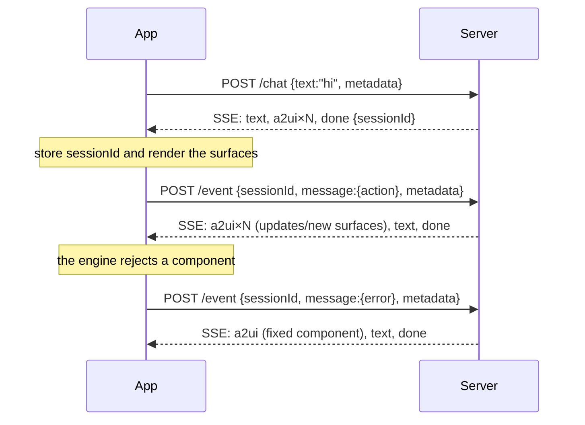

# 3. API reference (client contract)

Everything the Android (Compose) client needs to talk to this server. All examples were captured from the
running server.

- [Base URL](#base-url)
- [Conversation flow](#conversation-flow)
- [`POST /api/agent/chat`](#post-apiagentchat)
- [`POST /api/agent/event`](#post-apiagentevent)
- [`GET /health`](#get-health)
- [The `metadata` object](#the-metadata-object)
- [SSE response format](#sse-response-format)
- [Errors](#errors)
- [Client implementation checklist](#client-implementation-checklist)
- [Ktor example](#ktor-example)
- [Trying it with curl](#trying-it-with-curl)

---

## Base URL

| Where the app runs | Base URL |
|---|---|
| Android emulator | `http://10.0.2.2:3000` (the emulator's alias for your computer's `localhost`) |
| Physical device on the same Wi-Fi | `http://<your-computer-LAN-IP>:3000` (the server listens on `0.0.0.0`) |
| Physical device over USB | Run `adb reverse tcp:3000 tcp:3000`, then use `http://localhost:3000` |

Android blocks plain HTTP by default. In a **debug** build, allow cleartext traffic for these hosts with a network
security config.

---

## Conversation flow



- The **first** request has no `sessionId`. The server creates one and returns it.
- Every later request **must** send the same `sessionId`; otherwise the server won't know which surfaces exist.
- Each request returns **one SSE stream**, which the server closes after `done`.

---

## `POST /api/agent/chat`

The user typed a message.

**Request**

```http
POST /api/agent/chat
Content-Type: application/json
Accept: text/event-stream
```

```json
{
  "sessionId": "7c3f6124-d0b9-403b-9d28-5cadb3f7307e",
  "text": "plan a trip to Lisbon",
  "metadata": { "a2uiClientCapabilities": { "v0.9": { "supportedCatalogIds": ["https://a2ui.org/specification/v0_9/catalogs/basic/catalog.json"] } } }
}
```

| Field | Type | Required | Notes |
|---|---|---|---|
| `sessionId` | string | no (first call), yes afterwards | Returned by the server |
| `text` | string | **yes** | Non-empty after trimming |
| `mode` | `"mock"` \| `"hybrid"` \| `"llm"` | no | Overrides the server's `AGENT_MODE` for this session. Unknown values fall back to the default |
| `metadata` | object | recommended | See [metadata](#the-metadata-object) |

**Response**: `200 OK`, `Content-Type: text/event-stream`, header `X-Session-Id`. See [SSE format](#sse-response-format).

---

## `POST /api/agent/event`

Something happened in the UI: the user triggered an action, or the engine found an invalid component.

**Request: action**

```json
{
  "sessionId": "7c3f6124-…",
  "message": {
    "version": "v0.9",
    "action": {
      "name": "search_stays",
      "surfaceId": "trip",
      "sourceComponentId": "trip-search",
      "timestamp": "2026-11-04T18:05:33Z",
      "context": { "destination": "Lisbon", "checkIn": "2026-12-18", "checkOut": "2026-12-21", "guests": "2", "budget": 220, "vibes": ["food"] }
    }
  },
  "metadata": { "…": "…" }
}
```

`mode` works as for `/chat`.

All five `action` fields are required. `context` holds the button's `action.event.context` with every
`{"path": …}` **already resolved** to its current value.

**Request: client error**

```json
{
  "sessionId": "7c3f6124-…",
  "message": {
    "version": "v0.9",
    "error": { "code": "VALIDATION_FAILED", "surfaceId": "weather", "path": "/components/3/text",
               "message": "Missing required property 'text' in component 'Text'." }
  }
}
```

`VALIDATION_FAILED` needs `code`, `surfaceId`, `path` and `message`. Other error codes need `code`, `surfaceId`
and `message`.

`message` is validated against the official `client_to_server.json` schema. If it doesn't match, you get a `400`
(see [Errors](#errors)).

**Response**: same as `/chat`.

---

## `GET /health`

```json
{ "ok": true, "mode": "hybrid", "modes": ["mock", "hybrid", "llm"], "llm": true, "llmProvider": "claude", "llmModel": "claude-opus-5-5", "basicCatalogId": "https://a2ui.org/specification/v0_9/catalogs/basic/catalog.json" }
```

`mode` is the server default (`AGENT_MODE`), `modes` lists the values the `mode` request field accepts, and
`llm` tells you whether an LLM provider is configured, and `llmProvider` / `llmModel` which one (`null` when none). Use this endpoint to check that the app can reach the server.

---

## The `metadata` object

Send it with **every** request (`/chat` and `/event`). Both keys are defined by the A2UI spec.

```json
{
  "a2uiClientCapabilities": {
    "v0.9": {
      "supportedCatalogIds": [
        "https://a2ui.org/specification/v0_9/catalogs/basic/catalog.json",
        "https://example.com/catalogs/my-app/v1/catalog.json"
      ],
      "inlineCatalogs": [
        {
          "catalogId": "https://example.com/catalogs/my-app/v1/catalog.json",
          "components": {
            "FlightCard": { "type": "object", "properties": { "flightNumber": { "type": "string" } }, "required": ["flightNumber"] }
          },
          "functions": [ { "name": "shareTrip", "parameters": { "type": "object", "properties": { "url": { "type": "string" } } }, "returnType": "void" } ]
        }
      ]
    }
  },
  "a2uiClientDataModel": {
    "version": "v0.9",
    "surfaces": { "trip": { "destination": "Lisbon", "budget": 220 } }
  }
}
```

| Key | What the server does with it |
|---|---|
| `a2uiClientCapabilities["v0.9"].supportedCatalogIds` | Ordered by preference. The server only creates surfaces with these catalogs. If it's omitted, the basic catalog is assumed. |
| `a2uiClientCapabilities["v0.9"].inlineCatalogs` | Custom component and function schemas. Injected into the LLM prompt so the agent can use them. |
| `a2uiClientDataModel.surfaces` | Current data model per surface (sent when the surface was created with `sendDataModel: true`). Replaces the server's copy, so the agent sees the user's edits. |

The flat form `{"supportedCatalogIds": [...]}` (without the `"v0.9"` wrapper) is accepted too.

For `a2uiClientDataModel`, both the spec shape `{"version": "v0.9", "surfaces": {…}}` and the shape produced by
the Android library's `A2uiClientDataModel.toPayloadMap()`, `{"v0.9": {"surfaces": {…}}}`, are accepted.

On Android these objects come from the A2UI engine (`A2uiClientCapabilities` on the message processor). Check
how the alpha library serializes them, and adapt if needed.

---

## SSE response format

Standard [Server-Sent Events](https://html.spec.whatwg.org/multipage/server-sent-events.html). Each event has an
`id`, an `event` name, and **one** `data` line containing JSON. Real output for `{"text":"hi"}`:

```
: connected

id: 1
event: text
data: {"text":"Hi! Pick a demo, or just ask me for any UI."}

id: 2
event: a2ui
data: {"version":"v0.9","createSurface":{"surfaceId":"welcome","catalogId":"https://a2ui.org/specification/v0_9/catalogs/basic/catalog.json","theme":{"primaryColor":"#6750A4","agentDisplayName":"A2UI Demo Agent"},"sendDataModel":true}}

id: 3
event: a2ui
data: {"version":"v0.9","updateComponents":{"surfaceId":"welcome","components":[{"id":"root","component":"Card","child":"w-body"}, … ]}}

id: 4
event: done
data: {"sessionId":"7c3f6124-d0b9-403b-9d28-5cadb3f7307e"}
```

| `event` | `data` | What the client should do |
|---|---|---|
| `a2ui` | One A2UI v0.9 server → client message | Parse it and pass it to the A2UI message processor, **in order** |
| `text` | `{"text": "…"}` | Add an agent chat bubble |
| `status` | `{"text": "…"}` | Show a transient hint ("Thinking…", "Searching stays…"); clear it on the next event |
| `error` | `{"message": "…"}` | Show an error; `done` still follows |
| `done` | `{"sessionId": "…"}` | Store the `sessionId`; the turn is over and the stream closes |

Lines starting with `:` are comments (`: connected`, and `: ping` every 15 s). SSE clients ignore them.

**Timing matters.** Events arrive over time, not all at once. The trip form arrives in three batches about 400 ms
apart, and the booking status updates every 1.2 s. Render each `a2ui` event as soon as it arrives; don't wait
for `done`.

---

## Errors

| Situation | Response |
|---|---|
| `/chat` without a non-empty `text` | `400 {"error":"\"text\" is required"}` |
| `/event` with an invalid `message` | `400 {"error":"Invalid A2UI client message","details":["/action must have required property 'surfaceId'", …]}` |
| Agent fails during a turn (e.g. an LLM API error or a model refusal) | `200` stream containing `event: error`, then `event: done` |
| Action for an unknown action name | `200` stream with a `text` event explaining it |
| Client error on an unknown surface, or more than 2 repairs for one surface | `200` stream with a `text` event explaining it |

Once the stream has started, the HTTP status is always `200`. Failures arrive as `error` events.

---

## Client implementation checklist

- [ ] Send `metadata.a2uiClientCapabilities` with the catalog ids your `A2uiMessageProcessor` registers.
- [ ] Store `sessionId` from the first response and send it on every request.
- [ ] Read the stream **incrementally** and feed every `a2ui` event to the processor in order.
- [ ] Route every component action whose type is `event` to `POST /api/agent/event` as `{"version":"v0.9","action":{…}}`.
- [ ] Route engine validation errors (`VALIDATION_FAILED`) to `POST /api/agent/event` as `{"version":"v0.9","error":{…}}`.
- [ ] Attach `metadata.a2uiClientDataModel` for surfaces created with `sendDataModel: true`.
- [ ] Show `text` as chat bubbles and `status` as a transient indicator.
- [ ] Plug an image loader (e.g. Coil) into the basic catalog's `Image`. The demos load images from `picsum.photos`.
- [ ] Debug builds: allow cleartext HTTP to `10.0.2.2` and/or your LAN IP.
- [ ] Use a long read timeout (or none) for the SSE request; turns can last several seconds.

---

## Ktor example

A sketch using Ktor's SSE client plugin (`install(SSE)`). The names `processor`, `parser` and the request and
response data classes are placeholders for your own code.

```kotlin
@Serializable data class ChatRequest(val sessionId: String?, val text: String, val metadata: JsonObject)
@Serializable data class TextEvent(val text: String)
@Serializable data class DoneEvent(val sessionId: String)

suspend fun send(text: String) {
    client.sse(
        urlString = "$baseUrl/api/agent/chat",
        request = {
            method = HttpMethod.Post
            contentType(ContentType.Application.Json)
            setBody(ChatRequest(sessionId, text, metadata()))
        },
    ) {
        incoming.collect { event ->
            val data = event.data ?: return@collect
            when (event.event) {
                "a2ui"   -> processor.process(parser.parse(data))          // render progressively
                "text"   -> chat += Json.decodeFromString<TextEvent>(data).text
                "status" -> status = Json.decodeFromString<TextEvent>(data).text
                "error"  -> showError(data)
                "done"   -> sessionId = Json.decodeFromString<DoneEvent>(data).sessionId
            }
        }
    }
}
```

`/api/agent/event` works the same way, with a body of `{ sessionId, message, mode, metadata }`.

A complete client following this contract is the Android app in the parent folder (see `../README.md`).

---

## Trying it with curl

Start the server with `npm run mock`, then:

```bash
# Watch the stream live (-N disables buffering, -i shows headers including X-Session-Id)
curl -N -i -X POST localhost:3000/api/agent/chat \
  -H 'Content-Type: application/json' -d '{"text":"plan a trip to Lisbon"}'

# Press a button (replace SESSION with the X-Session-Id from above)
curl -N -X POST localhost:3000/api/agent/event -H 'Content-Type: application/json' -d '{
  "sessionId":"SESSION",
  "message":{"version":"v0.9","action":{"name":"search_stays","surfaceId":"trip","sourceComponentId":"trip-search",
    "timestamp":"2026-11-04T10:00:00Z","context":{"destination":"Lisbon","checkIn":"2026-12-18","checkOut":"2026-12-21","budget":220}}}}'
```

For a full scripted walkthrough with automatic checks, run `npm run smoke`.

Next: [4. Demo guide](04-demo-guide.md).
